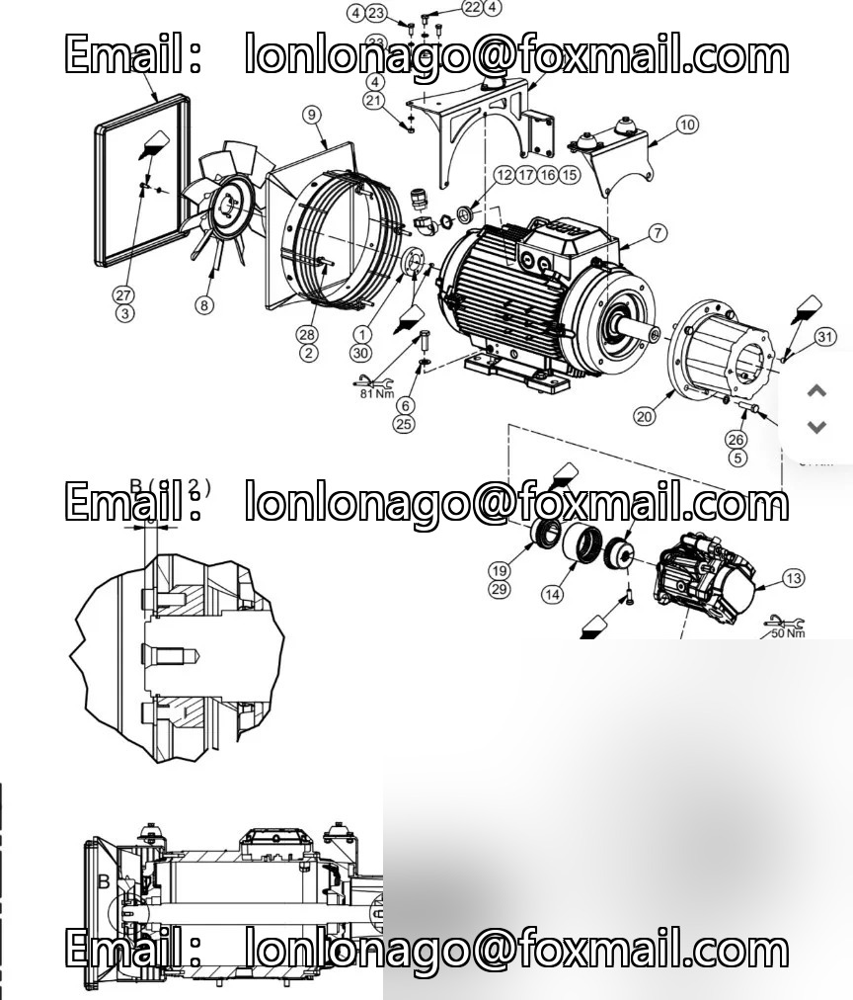
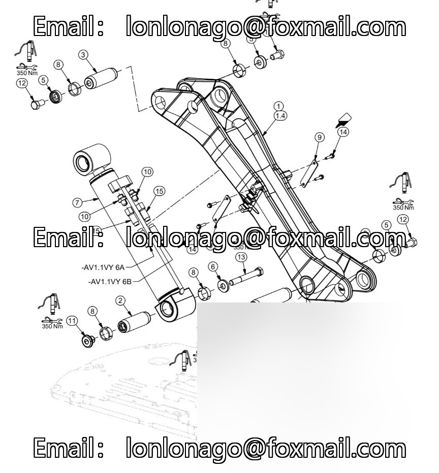
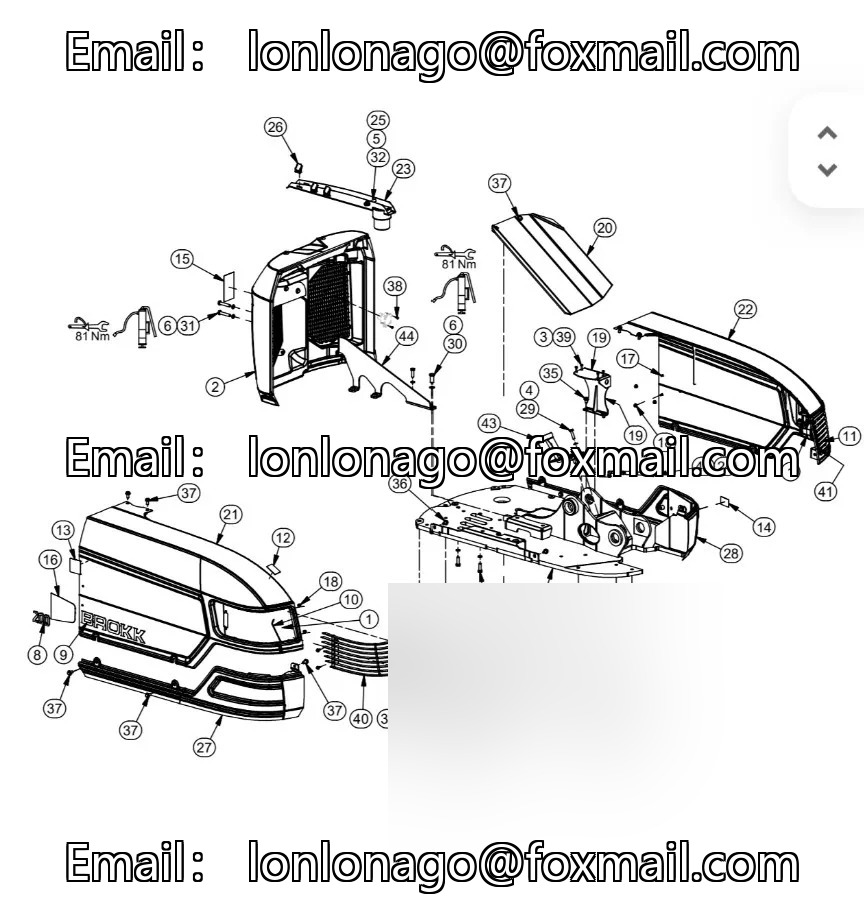
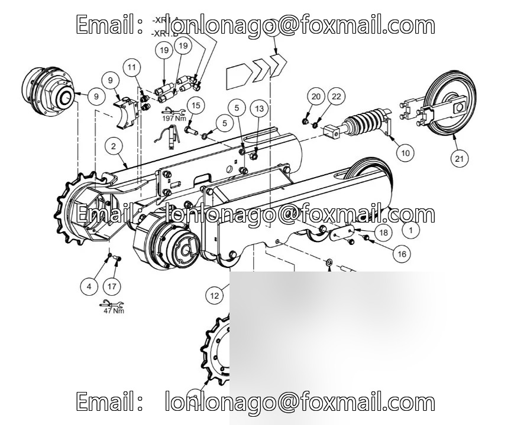
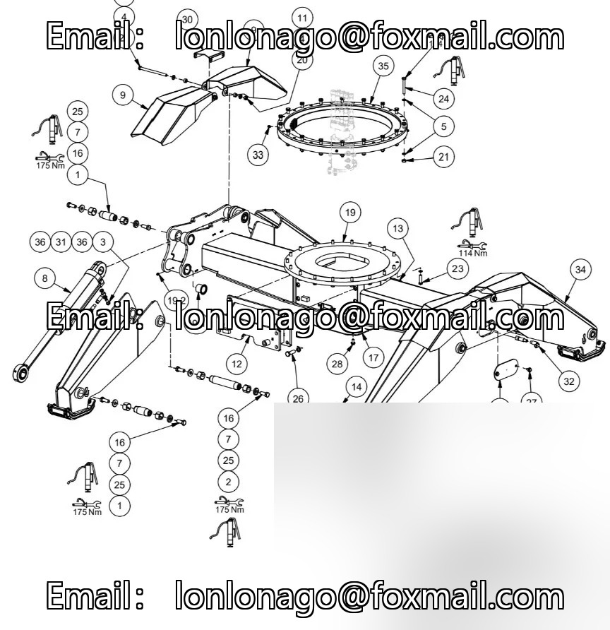

# Brokk 200 remote-controlled removal robot technical document

## Body

Brokk 200 Remote Remote Operation Disassembly Robot Technical Document
PDF , 138 pages, containing detailed content such as remote operation system, operation interface, mechanical structure, etc., suitable for maintenance, technical reference, and learning.
non-refundable after sale.

The technical document covers remote control systems, operation interfaces and mechanical structures, and is presented as a PDF of 138 pages, suitable for maintenance, technical reference and learning; it states sale is non-refundable.

<!-- AI_ENRICHED -->

## Images

## Payment

Here is a pay link on Stripe ( https://buy.stripe.com/3cs8yP7sY87d0vu9AB ). Please contact me lonlonago@foxmail.com after funding $89, and I will send you a complete data files , thank you!

